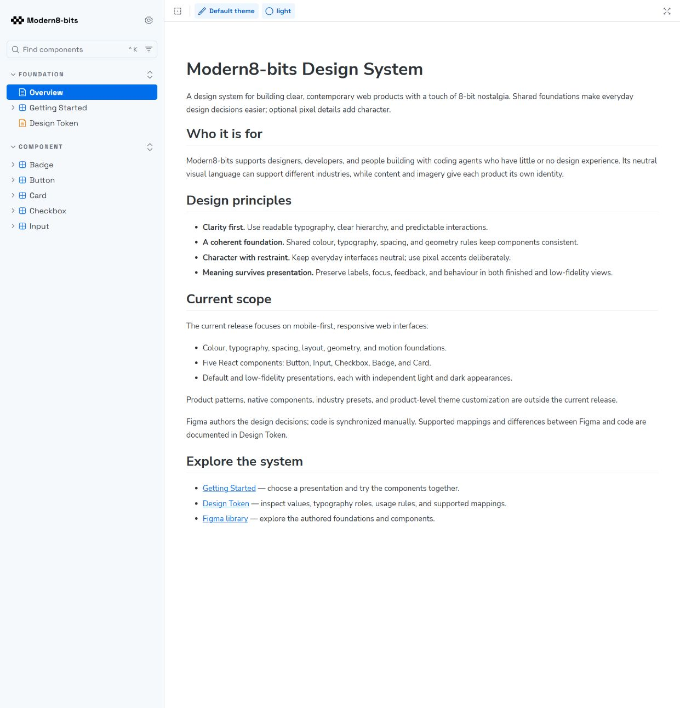
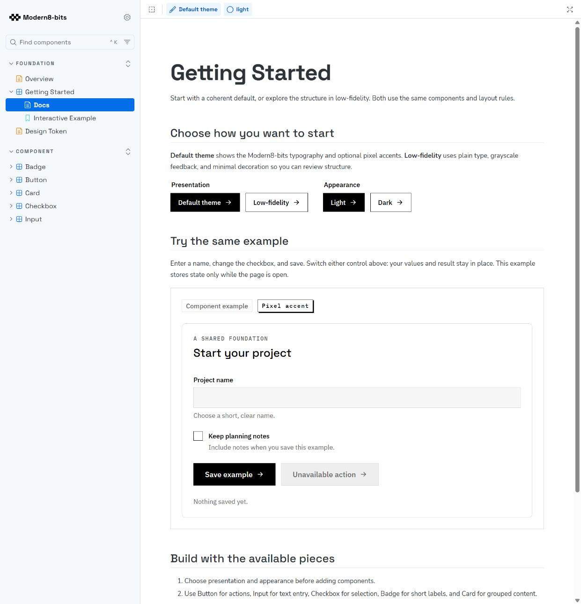
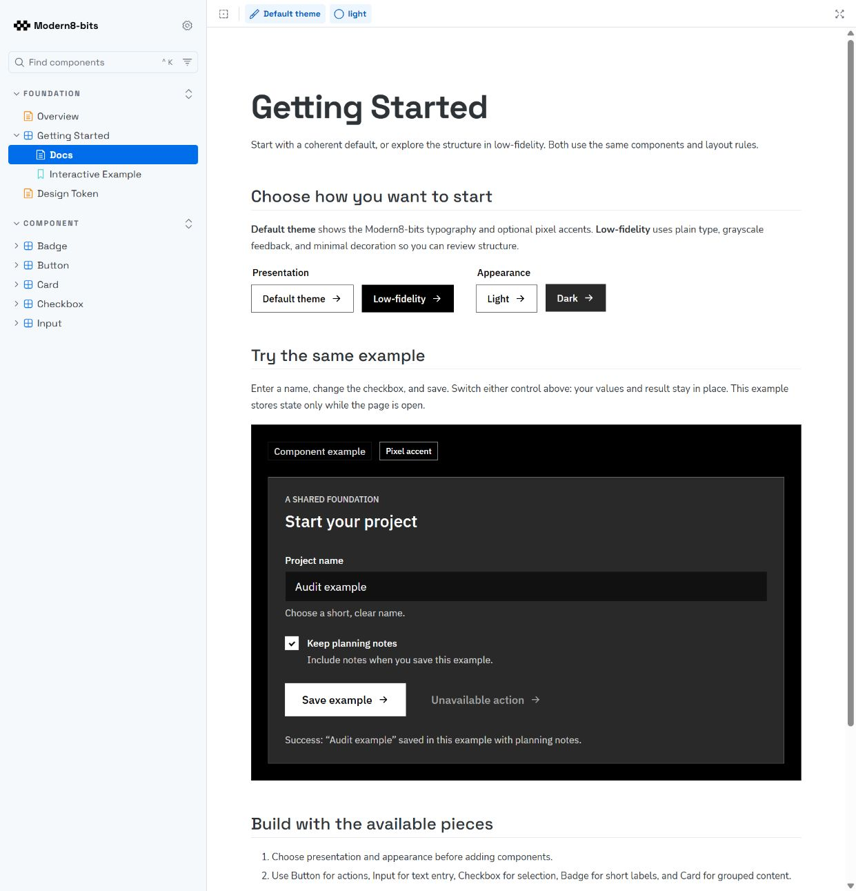
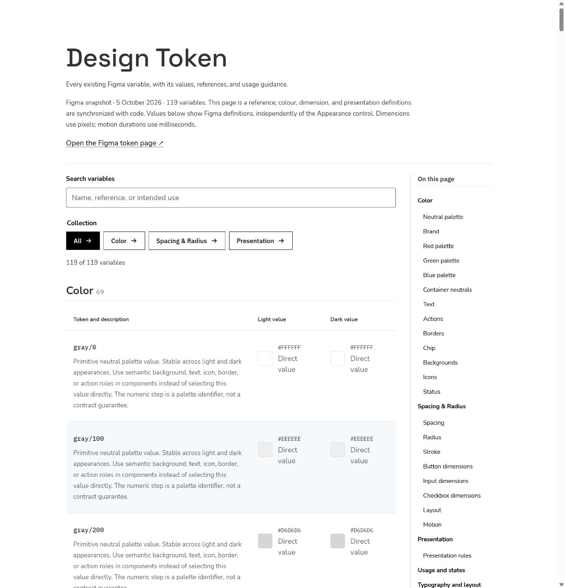
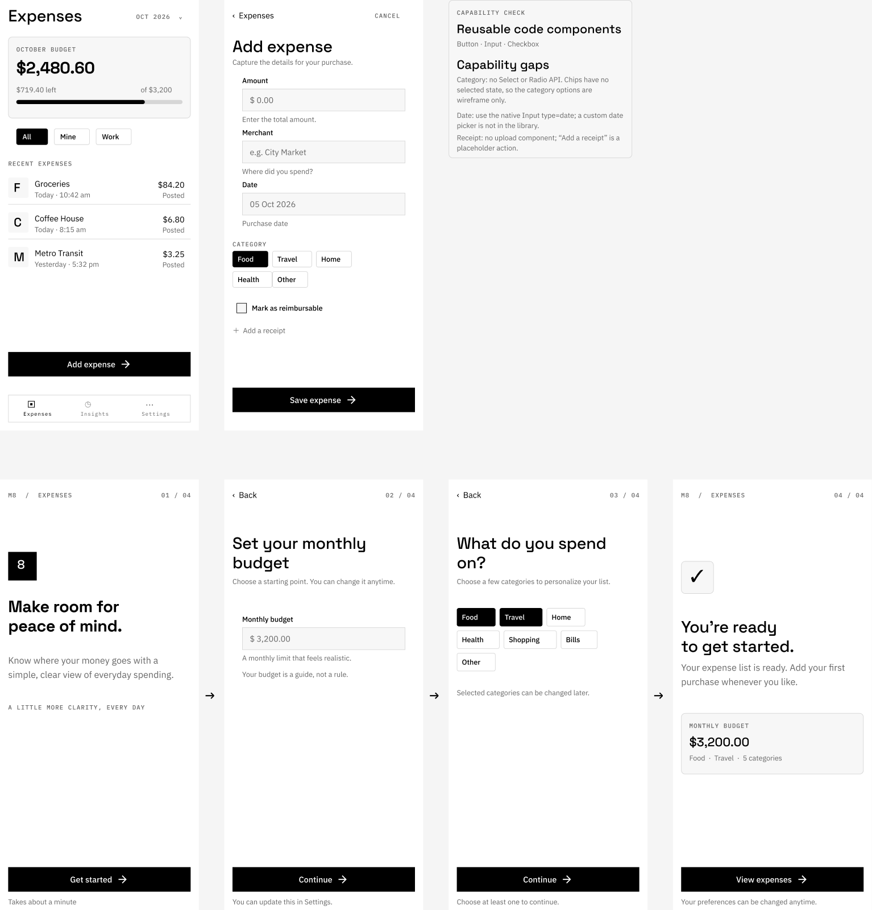
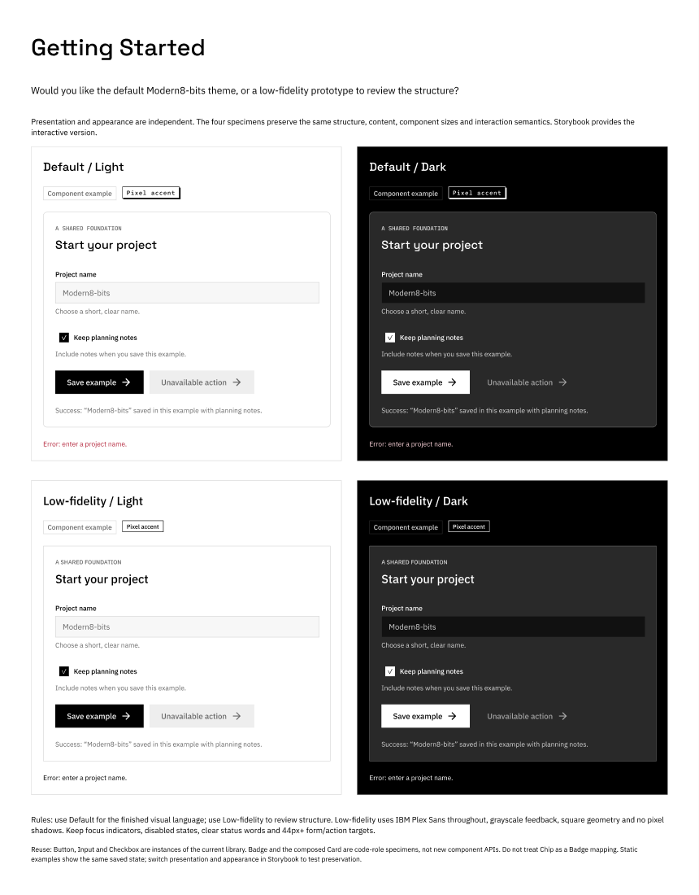
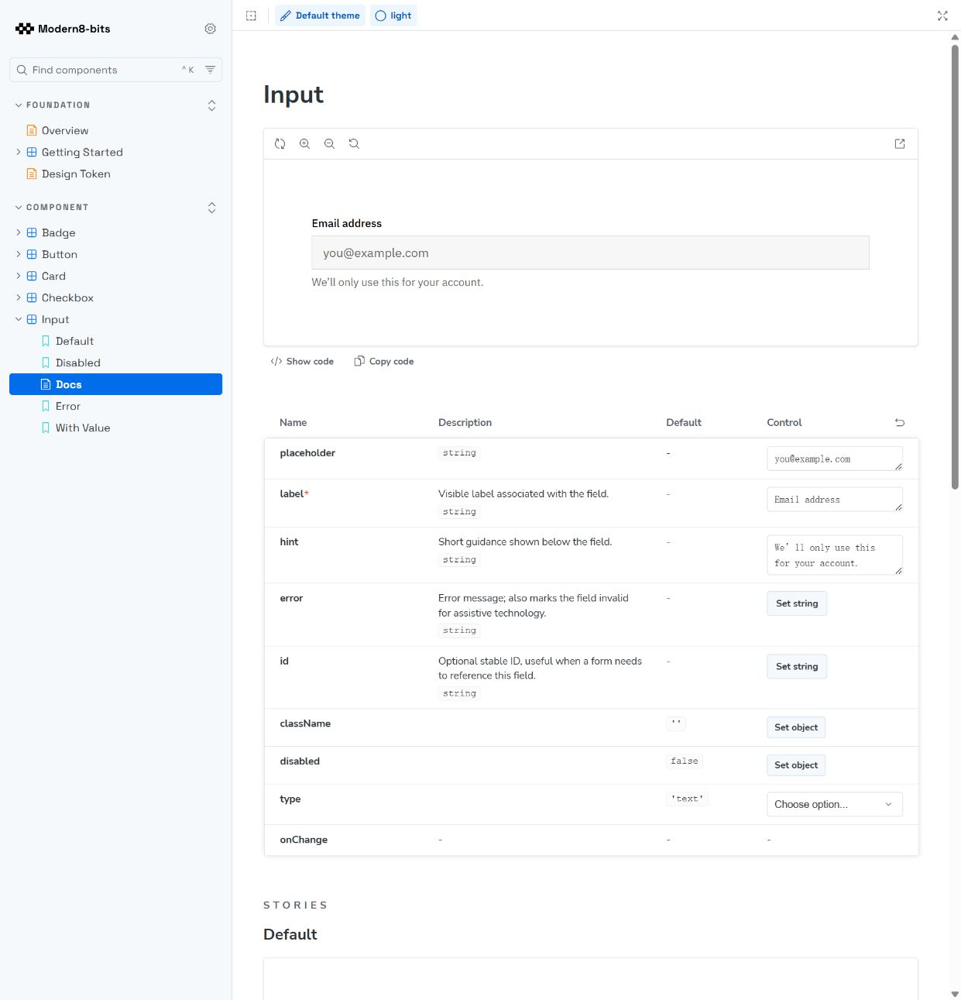
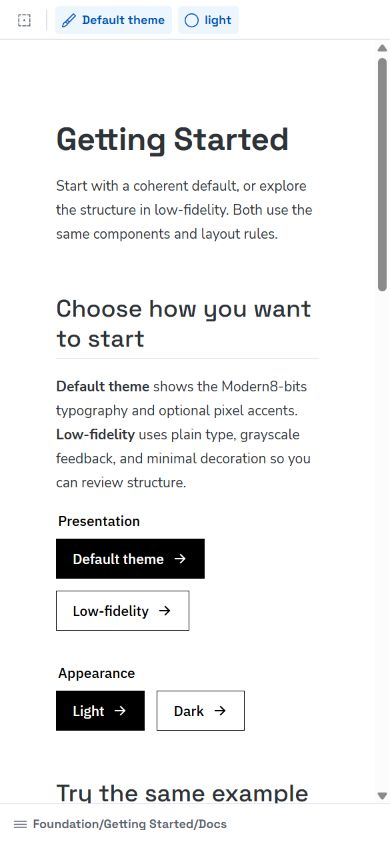

# Modern8-bits: Storybook and Figma audit

Audited 6 October 2026. Read-only review; no fixes applied.

## Verdict and scope

The token foundation is substantially ready. The larger gap is turning it into a dependable kit that a person without design skills can adopt and use with a coding agent. Figma also has two concrete implementation defects that weaken the interview claim of design-to-code consistency.

Reviewed the published Storybook at https://modern8-bits-up.vercel.app/, its Overview, Getting Started, Design Token and Input documentation, the live interactive example, mobile reflow, current local component implementations, and the current Figma file, including the supplied expense page 170:36, Themes and core component sets.

Assessment uses the confirmed foundations-first spec in ../foundations-first-release/spec.md. Product screens and new component families were outside that original release. Their absence is classified below as next-stage application readiness, rather than retroactively failing that release. Native support, industry presets and custom branding remain deferred.

## What is working

- All 119 current Figma variable definitions are represented in repository reference data. A fresh comparison of 264 resolved values found no differences. This verifies definition data, not every runtime CSS consumer or component binding.
- The 119 variables have descriptions and web mappings; 16 Figma text styles provide the documented typography roles.
- Storybook provides purpose, audience, token reference, supported mappings and an agent-readable local usage guide.
- The Getting Started example reports empty-name validation, accepts a name and checkbox choice, and preserves them and the save result when switching to Low-fidelity/Dark.
- That example uses the intended plain typography and grayscale treatment in Low-fidelity. The Figma four-mode comparison also demonstrates the intended typography; the issue is propagation into other assets.
- At 390px browser width, Getting Started reflows without measured horizontal overflow. Published Input labels and supporting text use IBM Plex Sans, and errors are connected through aria-describedby.

## Gaps, in recommended order

### 1. Figma Low-fidelity does not propagate into the expense screens — high priority

Evidence: step 5; six expense/onboarding frames explicitly select Presentation Low-fidelity and Color Light, but none of their 112 text nodes has a fontFamily variable binding. Space Grotesk and IBM Plex Mono remain visible. The inspected core Button, Input, Checkbox, Card and Chip assets also lack fontFamily bindings. Step 6 shows that the dedicated comparison already handles typography correctly.

Impact: selecting the promised structural mode gives inconsistent results, and coding agents can inherit the wrong visual treatment.

Next: bind the relevant typography families to Presentation roles at the reusable component level and in standalone page text. Review geometry and decoration bindings as part of the same pass, then verify representative instances in all four combinations.

### 2. The main Figma Button set contains a duplicate variant — high priority

Evidence: Button page 36:486, main component set 44:2, has two variants named `Color=Black, Variation=Ghost, Size=Lg, Status=Default`. Reading its componentPropertyDefinitions throws `Component set has existing errors`. The separate icon-only set does not show this problem.

Impact: the library's variant/property model is unreliable for inspection and reuse.

Next: resolve the duplicate, then recheck variant properties and dependent instances. This is a repair to the current library, not a request for a larger Button API.

### 3. Public onboarding stops before a user can adopt the system — high priority

Evidence: steps 1–3. Getting Started names USAGE.md as plain text but provides no direct guide/repository/starter link. USAGE.md explains local source imports; the library is not a published installable package.

Impact: a beginner can explore the demo but must work out how to obtain components, styles and fonts for a new project.

Next: offer one explicit adoption route, such as a small starter or a documented source-copy workflow; link it from public Getting Started. Include a copyable agent prompt with presentation choice and real API limits. A published package is optional.

### 4. Category selection has no reusable implemented interaction — high priority for the next product phase

Evidence: step 5. The Figma capability notes explicitly say category chips are wireframe-only and have no selected state. Radio exists in Figma, but not in the five-family code library. The add-expense screen needs one category; onboarding allows multiple categories.

Impact: an agent must invent behavior and accessibility for a common task.

Next: define single-selection and multiple-selection patterns using appropriate native semantics, states and keyboard behavior. Then align the Figma model and a coded Storybook example. Keep receipt upload deferred unless it is required for the chosen reference flow.

### 5. Documentation needs task guidance and a navigation repair — medium priority

Evidence: steps 4 and 7. Clicking Design Token inside Getting Started opens the standalone iframe URL and drops the Storybook sidebar and toolbar. Input documentation exposes props and states, but its type control only offers text/email/password/search/url. The real API accepts standard HTML attributes, while the expense reference relies on date and amount entry.

Impact: a beginner loses navigation context and cannot easily identify the correct input setup for the task.

Next: preserve manager navigation in cross-page links. Add concise purpose guidance, native date/number examples, amount-formatting limitations and single-vs-multiple selection guidance. Keep existing supported-subset mappings explicit rather than implying every Figma variant is implemented.

### 6. Application-level reuse has not been demonstrated across states and viewports — medium priority for the next product phase

Evidence: step 5. The six expense/onboarding frames are all 390×844, Light/Low-fidelity, and contain no prototype reactions. They provide a useful static narrative, but do not demonstrate an executable add/save flow, empty/error states, desktop behavior or appearance/presentation switching within that flow. Step 3 verifies switching only in the generic component example.

Impact: component-level success does not yet establish that the system supports a real mobile-first product coherently.

Next: build one small reference slice: expense list → add expense → validation → saved result. Include an empty list and one wider layout, and exercise all four mode combinations without expanding the whole application. This provides evidence of reuse; it does not require a complete finance product or industry presets.

### 7. Input boundary visibility and accessible descriptions need focused review — high priority before claiming accessibility readiness

Evidence: step 7. The published resting input uses border #D6D6D6 against fill #F7F7F7: measured contrast 1.36:1, or 1.45:1 against the surrounding white. This is a control-identification risk. Focus and error styling already exist. In step 3, the checkbox accessibility tree includes supporting copy in the accessible name; source places that copy inside the label and also references it via aria-describedby. Input and Checkbox also overwrite a caller-provided aria-describedby rather than merging it.

Impact: resting fields can be difficult to identify, and composed forms can lose or repeat supporting information.

Next: review the semantic token used for interactive borders, preserve consumer descriptions, and test keyboard and screen-reader behavior across the four mode combinations. A full accessibility conformance claim is outside this audit; duplicate spoken announcements were not verified with a screen reader.

### 8. Governance still lacks a worked release example — medium priority, original release requirement

Evidence: current TOKEN-RULE.md and USAGE.md establish rules and manual synchronization. The governance/validation issue 06 remains marked implementation not started. A release change log and a complete worked change were not found in the inspected tracked documentation.

Impact: the interview demonstrates rules, but does not yet show how a real change is managed and validated.

Next: use a genuine repair from this audit to trace Figma → definitions/CSS → component → Storybook → change log. Record affected checks, exact results and limitations; distinguish reviewed source from checks actually run.

## Captured walkthrough

### Step 1 — Overview: healthy positioning

Purpose, audience and foundation scope are clear. The transition into adoption is incomplete (gap 3).

### Step 2 — Getting Started: healthy demonstration, incomplete adoption

The presentation choice and component exercise are clear. USAGE.md is named without a usable public entry point (gap 3).

### Step 3 — Low-fidelity/Dark after saving: healthy state preservation

Entered data, checkbox selection and save feedback survive switching. The global toolbar and local example controls have independent scope, so public explanation would help. Checkbox descriptions warrant follow-up (gap 7).

### Step 4 — Design Token through the documentation link: healthy reference, navigation friction

The reference displays definitions, filters and a contents list, but navigation exits the Storybook manager (gap 5).

### Step 5 — Figma expense/onboarding page: useful structure, incomplete behavior and mode binding

The six screens establish a reference journey. Gaps 1, 4 and 6 prevent treating it as a verified reusable implementation. Receipt placeholder and native-date limitations are honestly recorded on the page.

### Step 6 — Figma four-mode comparison: healthy isolated demonstration

The comparison shows the intended distinction between appearance and presentation. It supports fixing propagation instead of redesigning the foundation (gap 1).

### Step 7 — Input documentation: healthy basic specimens, guidance and visibility gaps

Labels, basic states and props are available. Product-specific native input guidance and resting-border visibility need work (gaps 5 and 7).

### Step 8 — Getting Started at mobile width: healthy reflow

At 390×844, inspected content has no horizontal overflow. This checks the documentation page, not all library components or expense layouts.

## Recommended next move

Repair Figma presentation bindings and the duplicate Button variant first. Then make adoption concrete with a starter/guide entry point and validate one expense flow with proper category selection. Use those changes as the worked governance example.

## Evidence and limits

All screenshots and behavioral observations above were collected in this audit run. Figma was inspected read-only. `figma-variables.json`, `figma-component-inventory.json`, `figma-button-check.json` and `parity-check.json` retain inspection evidence. The 264-value parity check compares current Figma resolutions to current repository reference data; it is not a browser-wide CSS parity test. Source changes in the local working tree may not correspond to the published deployment.

This was a targeted design-system/adoption audit, not an exhaustive review of every Storybook story, assistive technology, browser or component variant. No new build or full test suite was run, and no financial calculations, persistence or receipt workflow were validated. No source or Figma changes were made.
