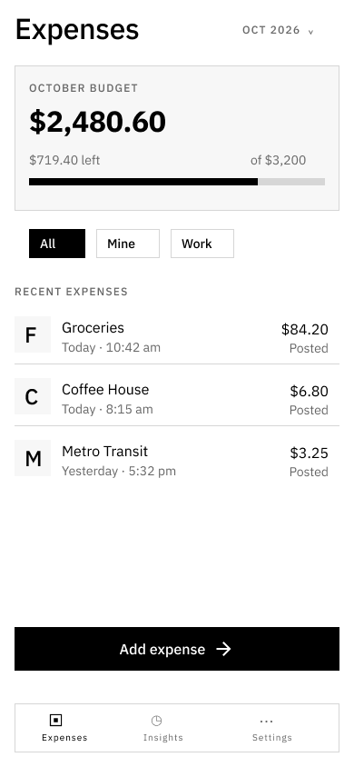

# Repairs 01–04

Completed 6 October 2026 following the user's instruction to fix the first four items in the proposed ticket breakdown. The remaining draft items were not implemented.

## 01 — Figma Button variants

Removed the unreferenced duplicate large Ghost component and its two text children. Kept the original Ghost and all remaining component IDs. The main set now contains 15 unique variants, and its property definitions can be read without the previous error. The duplicate had no instances before removal.

## 02 — Presentation switching

Bound all 16 shared text styles to the existing display/interface/detail Presentation font roles. Applied explicit bindings to the existing Button, Input, Card, Checkbox, Chip and Radio pages and the expense reference. Preserved Material Symbols Sharp icon glyphs rather than replacing them with text fonts.

Card, small-surface and Chip radii now follow Presentation. Added presentation/radius/small and presentation/radius/chip aliases, with their CSS/reference mappings. Status paint bindings in affected assets now follow Presentation where applicable. Existing hierarchy, content and component IDs were preserved.

Verified all six 390px expense/onboarding frames in Default/Low-fidelity × Light/Dark, then restored their original Light/Low-fidelity settings. Default uses Space Grotesk, IBM Plex Mono and IBM Plex Sans with the intended radii. Low-fidelity uses IBM Plex Sans for all product text and has no rounded descendant surfaces. The structural clipping check found no text extending outside clipping parents in those frames.

## 03 — Input visibility

Added border/input, aliasing gray/600 in Light and gray/400 in Dark. Enabled resting inputs use it in Figma and CSS. Decorative border/default, disabled borders, focus indicators and error treatments keep their separate roles.

Measured resting-border contrast: 5.36:1 against the light input fill and 5.74:1 against the light canvas; 7.49:1 against the dark fill and 8.33:1 against the dark canvas. These measurements are specific to the current input surfaces, not a general accessibility certification.

## 04 — Accessible descriptions

Input and Checkbox merge caller-provided aria-describedby references with generated hint/error references and remove duplicate IDs. Checkbox uses an explicit label reference, so supporting copy is a description rather than part of its accessible name. Caller-provided aria-label and aria-labelledby remain supported. Clicking supporting copy still toggles the checkbox; Space and Tab behavior remain intact.

Added composed-description stories exercising normal/error fields, external context, duplicate references, custom checkbox naming and keyboard interactions in all four mode combinations.

## Validation

- Application TypeScript/production build: passed.
- Storybook production build: passed; emitted the existing large-chunk advisory.
- Configured Chromium Storybook suite: 6 files passed, 25 checks passed.
- Current Figma/reference parity: 122 definitions, 274 resolved-value comparisons, zero differences. All variables have descriptions and web mappings; all 16 shared text styles have font-family bindings.
- Final expense-list screenshot captured and visually inspected. Four-mode expense-frame structural checks passed as described above.
- Reviewed React changes for stable IDs, label/description semantics and preservation of controlled/uncontrolled behavior. No new effects or state were needed for the component repairs.

The restricted build process initially could not resolve a project file, and the restricted test process could not locate Chromium. Validation succeeded using the normal host process and the existing Chromium installation; no browser download was needed.

No NVDA/VoiceOver session was performed. Accessible names and descriptions were verified with browser assertions; spoken output remains unverified. The full library was not certified for accessibility. Figma changes are live in the supplied file. Code changes remain local; the published Storybook has not been redeployed and no commit or push was performed.

See presentation-repairs.json for affected Figma node IDs, figma-variables.json for the updated definitions and style bindings, and parity-check.json for comparison/contrast results. The original audit remains an unchanged record of the pre-fix state.
