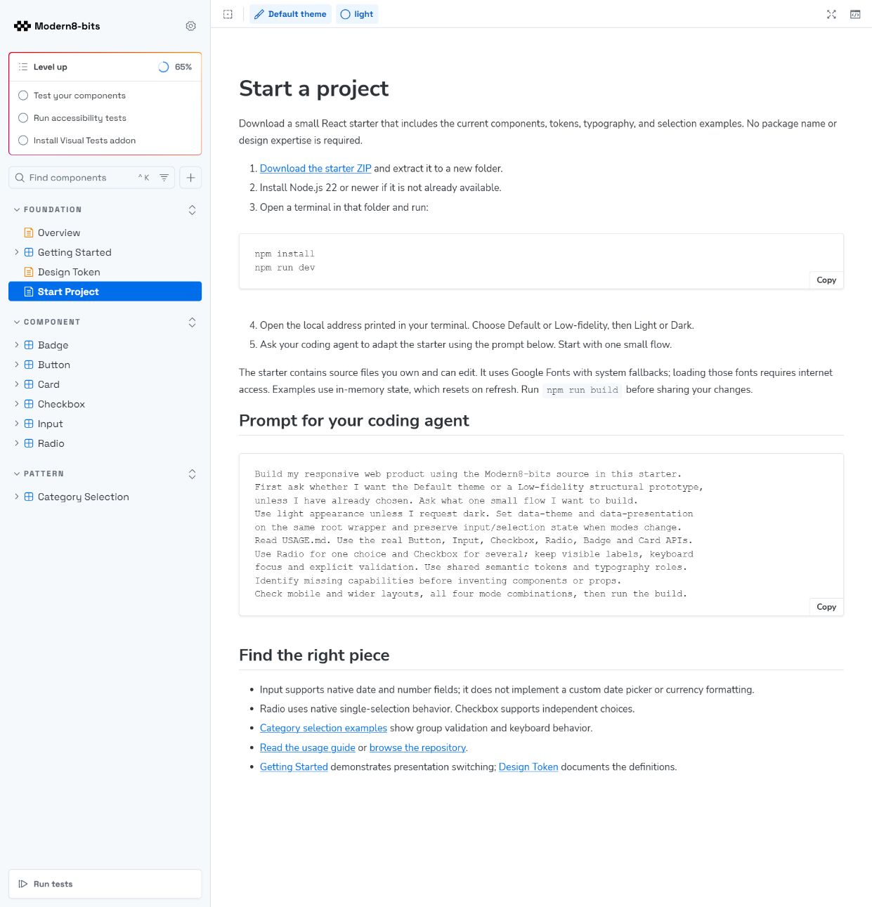
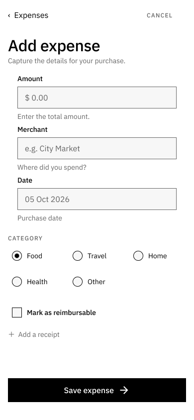
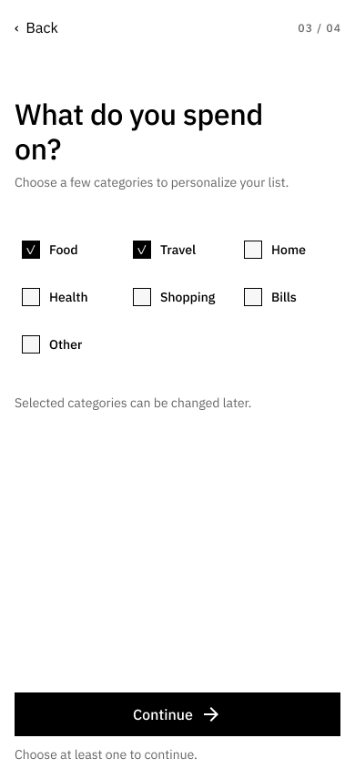

# Repairs 05–08

Completed 6 October 2026. Scope follows the proposed ticket breakdown, not the original audit gap numbering.

## 05 — Storybook navigation and input guidance

Foundation cross-links now target the Storybook manager rather than the standalone iframe. Verified the Getting Started → Design Token link in the local built preview; the sidebar and toolbar remain present. Getting Started explains the difference between local example controls and global story controls.

Input now includes native date and amount stories and controls. Examples explain browser-dependent date rendering, YYYY-MM-DD values, min/step validation and currency-formatting limitations. Browser assertions cover valid date input, negative amount rejection and excessive decimal precision. No custom date picker or currency formatter is claimed.

## 06 — Beginner adoption route

Added Foundation / Start Project with a downloadable ZIP, setup steps, source/guide links and a copyable coding-agent prompt. The generator packages current component and pattern source without Storybook stories, includes tokens/styles/fonts, pins the installed React/Vite/TypeScript versions, and provides a standalone app with presentation/appearance controls.

Extracted the archive into an independent consumer directory, installed its dependencies using the existing npm cache, and built it successfully. This consumer has its own dependencies and no dependency on the Storybook installation. Google Fonts require network access; system fallbacks are documented. The starter has in-memory state and no backend.

## 07 — Single-category selection

Added an exported React Radio component using native radio semantics, group names, visible labels and supporting descriptions. The coded Category Selection pattern demonstrates one choice, group validation and submission. The four-mode browser story verifies arrow-key selection, exclusivity and the submitted result.

Replaced the expense form's five category chip wireframes with instances of the existing Figma Radio component. Food is shown selected. The Figma Radio set now documents its code mapping, native rendering differences and the supported 20px code indicator/44px label target. Existing richer Figma sizes remain distinct from the code API.

## 08 — Multiple-category selection

The coded pattern uses the existing Checkbox for independent category choices, requires at least one selection, and links the group error to affected controls. Checkbox now respects caller-provided aria-invalid when no individual error prop is present. Browser checks exercise empty submission, Tab/Space selection, multiple submitted values and removing one selection while retaining another.

Replaced onboarding's seven chip wireframes with existing Figma Checkbox instances. Food and Travel are shown checked. Both Figma groups use auto-layout rows; surrounding copy was adjusted to avoid overlap. Capability notes now describe the implemented selection patterns while retaining date-picker and receipt-upload limits.

## Validation and limits

- Application TypeScript/production build passed.
- Storybook production build passed, including the Start Project route and starter ZIP.
- Configured Chromium suite: 8 files, 32 checks passed, including selection interactions and configured accessibility assertions across the four appearance/presentation combinations.
- Clean starter install and standalone production build passed.
- Manager-preserving navigation verified in the in-app browser; setup page and both Figma selection screens captured and visually inspected.
- Starter and usage-guide download routes returned HTTP 200 in the local preview.
- At a 390px viewport, the selection preview content measured 375px wide with a 375px scroll width: no horizontal content overflow. The Storybook manager toolbar has its own horizontal scrolling.
- The native control rendering can vary by browser. This does not establish screen-reader or cross-browser certification. The Figma screens show selection states, not a fully wired application prototype; interaction is implemented in the coded examples.

Figma edits are live. Storybook code and downloadable assets are local and require redeployment to appear publicly. No commit or push was performed. Tickets 09 and 10 were not implemented.
